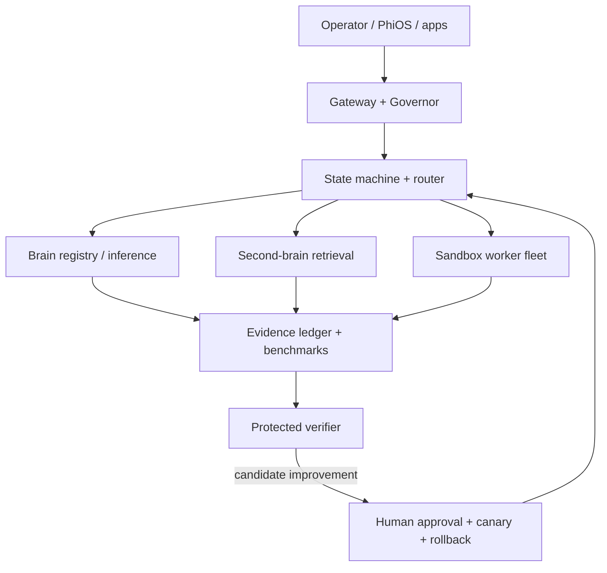

# Φ PhiCortex: Council Synthesis v0.1

## Mission

Build a **CPU-first, local-first distributed cognitive operating system**, increasing *verified capabilities* over time rather than asserting superintelligence from orchestration alone. Models are replaceable workers; core knowledge and policies remain independently owned and inspectable.

## Council responsibilities

| Contributor | Architecture insight preserved |
| --- | --- |
| GPT / CortexMesh | Shared contracts, CPU-first bootstrap, deterministic mathematics and measurements |
| Meta / ORION | Orchestration, task frames, worktree isolation and permission tiers |
| Kimi / AURORA | Measured capability registry, cost ledger, outcome-trained routing candidates |
| Grok / LATTICE | Explicit CHAT/DREAM/BUILD/TEST state machines, interchangeable specialists |
| Claude / NEXUS | Independent Governor, protected evaluation sets, permission enforcement |
| Gemini / AETHER | Measured CPU-to-GPU escalation, independent adversarial test workers |
| Vessie / DREAMER | Explicitly speculative cross-domain hypotheses and reality-bridge tests |

These are functional inspirations, not claims that seven named AI services are connected.

## Data flow

**Current implementation:** Gateway, deterministic router, Ollama adapter, append-only-in-practice SQLite event recording, health endpoint and tests. The diagram's Governor, memory retrieval, fleet, verifier and promotion gates are future requirements, not implemented safeguards.

## Shared task contract (target, not implemented)

Task frame: `task_id`, `actor_id`, `mode`, `goal`, `project_ref`, `allowed_actions`, `input_refs`, `context_budget`, `time_limit`, `max_tokens`, `resource_requirements`, `output_schema`, `correlation_id`.

Worker result: `task_id`, `status`, `artifacts[]` with SHA256 hashes, `test_evidence[]`, `route_trace`, `duration_ms`, `resource_usage`, `provenance`, `unverified_claims[]`.

No prompt or tool response can grant new permissions. Signed policy and authenticated identities, not natural-language claims, are the source of authority.

## Milestones

1. **Phase 1 (this PR)**: local CPU-compatible inference proxy, deterministic routing, persistent metrics and tests. Streaming, verified CPU-only execution and content memory remain open.
2. **Phase 2**: real state-machine modes, deterministic math/unit engine, versioned project notes and full-text retrieval; prevent untrusted data becoming executable instructions.
3. **Phase 3**: policy-enforced isolated Build/Test agents, file manifests, protected regression suite and browser Reader separation.
4. **Phase 4**: authenticated multi-PC workers, resource discovery, durable at-least-once queue, safe retries, artifact sync and recovery.
5. **Phase 5**: Dream consolidation and exploratory hypothesis proposals; benchmarked routing candidates promoted only after external verification, canary and rollback.
6. **Later**: optional MCP/A2A and provider adapters, hardware-calibrated GPU/NPU tier, adapter training. External data transfers need scoped approval.

## Acceptance criteria

- CPU-only test on target PC proves no GPU execution, with measured time/RAM, not a prompt assertion.
- A request can pass through local gateway into an installed model with no external network dependency.
- Events persist across restart and transcript capture is off by default.
- Unauthorized tool and model requests are denied, and destructive actions cannot bypass a Governor once introduced.
- Build/test worker code never executes unsandboxed on host; worker denial and resource limits are exercised with adversarial tests.
- Versioned files and memory can be exported, corrected and deleted according to explicit retention policy.
- No candidate model/route/policy change is promoted solely because it scored itself highly.

## Unresolved engineering decisions

- Test isolation backend on Windows/WSL2 vs separate Linux KVM host.
- Local inference benchmark and exact model registry: verify actual Ollama names and GGUF requirements.
- Select one source-of-truth format for memory and a rebuildable semantic index.
- Quantify routing success on an independently curated held-out suite before training any router.

## Nova-inspired integration (review PR)

An optional local browser workspace and `HistoryStore` expose Nova-style conversations, cursor history, retry keys, FTS5 search and deletion. The store is activated only with `PHICORTEX_ENABLE_HISTORY=1` because transcripts are plaintext. This adds a conversation memory foundation but does not implement semantic or procedural memory. It uses the existing Ollama-compatible gateway (no new model downloader or runtime), and token trimming is only approximate pending a verified token-counting adapter. See `docs/NOVA_INTEGRATION.md` for attribution, boundaries and remaining parity gaps.

## Measured Brain Colony v1 (candidate implementation)

A role registry (chat/code/optional reason), explainable deterministic-v2 routing,
per-model operational telemetry, and a CLI for known-answer local model comparison
form the first measurement baseline. Neither the model registry nor the sample
cases establish model intelligence or verified CPU-only execution. Model promotion,
protected held-out benchmarks, calibrated risk, and adaptive policies remain future work.
See [Measured Colony](MEASURED_COLONY.md).

## Guarded worker v0 (candidate)

A CLI-only `build-check`/ `test` prototype requires explicit operator opt-in,
a pinned container image, fixed Python commands, verified local Docker context
and a registered gVisor `runsc` runtime. It mounts only a read-only workspace,
blocks network access and refuses unrecognized task plans. This is **not** the
Governor, distributed mesh, or a proven isolation boundary against hostile code.
The higher-security execution and artifact/approval contracts remain future work.
See [Guarded Worker](GUARDED_WORKER.md).
