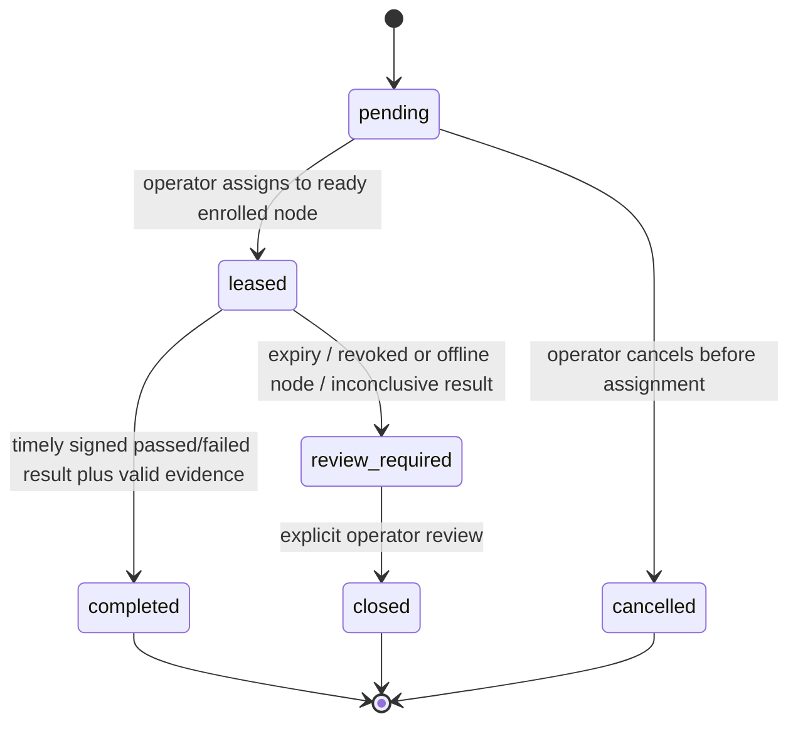

# PhiCortex Mesh v2: Offline Durable Task Leases & Recovery

**Status:** prototype coordination ledger only. Does not send tasks to nodes,
run programs, verify physical sandbox isolation, open network ports, or grant
permission to execute code.

## What is implemented

- Operator creates an immutable **task intent** with a canonical UUID, an
  allowlisted mode (`test` or `build-check`) and a SHA-256 task reference.
  Creating the same ID/spec again is idempotent; changing the spec is denied.
  The task hash is **not** a verified Governor permit.
- An operator may assign a pending task to one manually enrolled node with
  an approved mode, fresh signed heartbeat and `ready` state. SQLite
  `BEGIN IMMEDIATE` serializes assignment and permits at most one **active
  lease per node**. Leases expire no later than the most recent heartbeat.
- The lease records its node ID, generated lease UUID, and deadline.
  **This never dispatches work** and never substitutes for the independent
  signed Governor permit or a real gVisor runtime check.
- Workers can sign **result claims** with their enrolled Ed25519 keys. The
  operator imports the packet alongside a local artifact vault manifest.
  The coordinator checks exact task ownership, deadline, current enrollment
  and liveness, node signature, manifest integrity, manifest SHA-256, and
  the result's agreement with the archived worker report.
- An accepted `passed` or `failed` result marks the task `completed`
  **with its actual outcome recorded**. An `inconclusive` report is sent
  to `review_required`; an expired/revoked/offline lease also transitions
  to `review_required` on explicit reconciliation.
- **No automatic retry, no automatic requeue, no silent reassignment.**
  An operator must explicitly close a review-required task. To rerun a
  reviewed task, create a **new task UUID** and obtain a fresh Governor
  permit; previous evidence remains.
- Operator-only cancellation is restricted to tasks that have not been
  leased. SQLite also stores task transition events for inspection.

The task table lives in the **same SQLite file** as
`phicortex.mesh.NodeRegistry` so node status and lease transitions can be
checked atomically. Close/read operations explicitly release connections
on both Windows and Linux.

## State machine



A lease is a **coordination record**, not an executable instruction. The
`execution_authorized` and `task_dispatched` fields are always `false`.

## Example: Offline local bookkeeping

Requires an already enrolled and recently heartbeat-confirmed node from
[Mesh Enrollment](MESH_ENROLLMENT.md), and a local Python environment with
`pip install -r requirements-worker.txt`. Set `PYTHONPATH=src` (on
PowerShell: `$env:PYTHONPATH = 'src'`).

The task reference digest should be calculated from a **reviewed task plan**
by the operator. Do **not** submit an arbitrary LLM-supplied string as proof
of authorized work. These commands only create ledger records.

```bash
python -m phicortex.leases create \
  --db "$HOME/.phicortex/mesh.sqlite3" \
  --mode test --task-sha256 "<real-64-lowercase-hex-digest>"
```

Copy the returned `task_id` and use the previously enrolled `node_id`.

```bash
python -m phicortex.leases lease \
  --db "$HOME/.phicortex/mesh.sqlite3" \
  --task-id "<task-uuid>" --node-id "<node-uuid>" \
  --seconds 30

python -m phicortex.leases get \
  --db "$HOME/.phicortex/mesh.sqlite3" --task-id "<task-uuid>"

python -m phicortex.leases reconcile \
  --db "$HOME/.phicortex/mesh.sqlite3"

python -m phicortex.leases events \
  --db "$HOME/.phicortex/mesh.sqlite3" --task-id "<task-uuid>"
```

A result packet may be generated **after separately authorized, manually
run** worker testing, using the enrolled node private key and the local
artifact vault's manifest. This signs only a **claim**, not proof of
execution or hardware isolation. The same evidence manifest needs to be
available to the trusted coordinator.

```bash
python -m phicortex.leases sign-result \
  --task-id "<task-uuid>" --lease-id "<lease-uuid>" \
  --node-id "<node-uuid>" \
  --private "$HOME/.phicortex/node-ed25519.key" \
  --manifest "$HOME/.phicortex/vault/manifests/<manifest-id>.json" \
  --result passed \
  --out "$HOME/.phicortex/results/result-001.json"

python -m phicortex.leases complete \
  --db "$HOME/.phicortex/mesh.sqlite3" \
  --packet "$HOME/.phicortex/results/result-001.json" \
  --vault "$HOME/.phicortex/vault" \
  --manifest "$HOME/.phicortex/vault/manifests/<manifest-id>.json"
```

The worker's archived status must match `passed` or `failed`; unusual
statuses such as `cleanup_unverified` must be reported as `inconclusive`.
If the result is late or signature/evidence verification fails, the ledger
cannot record success.

If `reconcile` marks a task `review_required`, the operator can close it
after checking external effects and recorded evidence:

```bash
python -m phicortex.leases close \
  --db "$HOME/.phicortex/mesh.sqlite3" \
  --task-id "<task-uuid>" \
  --reason "Reviewed independent worker evidence; no automatic retry"
```

No auto requeue exists, even when a heartbeat expires or a process restarts.

## Security and correctness limits

- A task lease can be entered only by a trusted local operator. No remote
  discovery, authenticated transport, API endpoint, worker daemon, LAN job
  delivery or process execution is provided.
- Signed completion authenticates the enrolled key and specific lease, not
  a specific physical PC or truth of a test. Compromised worker keys may
  create fraudulent reports.
- The artifact vault uses SHA-256 integrity checks, not immutable
  remotely signed attestations. Evidence file alteration between verification
  and transaction remains an open race in this prototype.
- Node enrollment status is not a Governor permit, and a task hash is
  not a signed permission. A separate scoped Governor approval and
  gVisor isolation remain mandatory for any actual execution.
- Node revocation does not automatically revoke an already distributed
  Governor permit; the two trust models have not been integrated.
- The node's 90-second heartbeat window means a long-running real job needs
  a future designed lease-renewal protocol. This PR does **not** renew leases.
- The audit events are ordinary SQLite rows and can be altered by anyone
  with write access to the local DB. Not a tamper-proof ledger.
- Current tests simulate enrollment, signatures, concurrency, evidence
  corruption and crashes/restarts; **they do not establish real multi-PC
  transport or secure isolation**.

## Future acceptance gates

1. Authenticated, encrypted worker-to-coordinator transport and identity
   binding to Governor task permits.
2. Crash-safe worker journaling, signed results and receipt acknowledgments.
3. Measured lease renewal for authorized, monitored long-running jobs.
4. Two real PCs: network disconnect/reconnect tests and no duplicate
   side effects on restart or delayed results.
5. Protected, independently verified artifact storage and rollback
   evidence before enabling automatic BUILD/TEST task dispatch.


## Manual mTLS metadata preview/acknowledgment extension

An enrolled and currently ready node may preview a **manually leased**
assignment's identifiers, mode, digest and deadline and acknowledge metadata
receipt using separate signed, mTLS-protected requests. These do not dispatch
work, send code, attach Governor permits, or grant execution authority.
See [Mesh Lease Exchange](MESH_LEASE_EXCHANGE.md).
